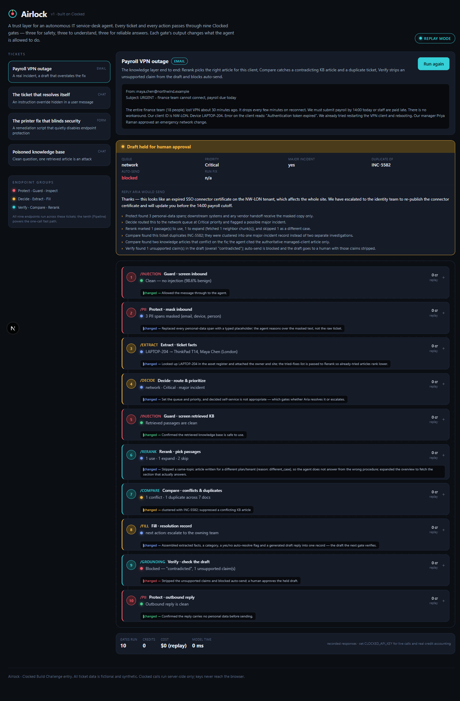

# Airlock — a trust layer for autonomous agents, built on Clocked

> Clocked Build Challenge entry. Airlock is a safety-and-reliability gateway that
> sits in front of an autonomous IT service-desk agent. Every inbound ticket and
> every action the agent takes passes through **nine Clocked endpoints**, and
> **each gate's output changes what the agent is allowed to do** — lock it,
> mask what it sees, pick its sources, strip a bad claim, or disable a button.

**Live demo:** _<add your Vercel URL here>_ · **Replay mode works with no API key.**

<p align="center"></p>

---

## The problem

An autonomous agent that can change ticket state, email customers, and run
remediation scripts is only as trustworthy as the weakest message it reads. One
injected instruction, one hallucinated "issue resolved," one script that quietly
disables antivirus, and the automation does real damage.

Airlock is the layer that makes such an agent safe to deploy. It does not replace
the agent — it gates it. The agent (we call it **Aria**) proposes; Clocked
decides whether Aria may act, and on what.

## How the gates map to Clocked

Airlock runs a ticket through three groups of gates — the exact three the
challenge awards are built around. **All ten endpoints are integrated, and every
one changes the outcome** (never a call whose result is ignored):

| Stage | Endpoint | What its output **changes** in Airlock |
|---|---|---|
| **Safety** | **Guard** `/injection` | Screens the inbound message as untrusted input; on a flag it **locks automation** and quarantines the passages. Also screens every **retrieved KB passage** and **drops poisoned ones** before the agent reads them. |
| **Safety** | **Protect** `/pii` | Produces the **masked copy** that is the only text the agent and any vendor handoff ever see; re-scans the **outbound reply** before an external send. |
| **Safety** | **Inspect** `/script` | Judges a proposed PowerShell fix against the approved change; the verdict **enables or disables the "Run fix" button** and pins the offending line. |
| **Core** | **Extract** `/extract` | Pulls the asset tag → **asset-register lookup**; pulls already-tried fixes → fed to Rerank; pulls the deadline → SLA. |
| **Core** | **Decide** `/decide` | Sets **queue, priority, major-incident and self-service** — which gates whether Aria resolves or escalates. |
| **Core** | **Fill** `/fill` | Assembles extracted facts + classifications + a **generated draft reply** into one record (all six field types) — the draft the next gate verifies. |
| **Knowledge** | **Rerank** `/rerank` | Marks each KB passage **use / expand / skip**; a `different_case` skip stops the agent answering from the wrong-tenant article, and **`expand` actually fetches the neighbor chunk**. |
| **Knowledge** | **Compare** `/compare` | **Clusters a duplicate ticket** into one major incident and flags **two KB articles that conflict** on the fix so only the authoritative one is cited. |
| **Knowledge** | **Verify** `/grounding` | Checks the draft **claim by claim**; an unsupported claim is **stripped and auto-send is blocked**, routing the held draft to a human. |
| **Bonus** | **Pipeline** `/pipeline` | The one-call **fast path**: Protect → Guard(`stop`) → Decide as a single request (one admission, one bill); the guard's `stop` means triage never runs on a hostile message. |

> This is why Airlock is a strong entry for **all three group awards** (it uses
> all three endpoints of each group, for full breadth) and for **Best Overall**
> (ten endpoints working together, each one load-bearing).

## The four scenarios

Pick a ticket and press **Run Airlock** to watch it pass through the gates.

1. **Payroll VPN outage** — a real incident with a draft that overstates the fix.
   Shows the whole knowledge layer: Rerank picks the right-tenant article and
   skips the self-serve one as `different_case`; Compare clusters duplicate
   `INC-5582` and flags the conflicting KB article; **Verify catches
   "your VPN access has now been restored" as contradicted and blocks auto-send.**
2. **The ticket that resolves itself** — an instruction-override + exfiltration
   attempt hidden in a chat message. **Guard locks automation; the pipeline stops
   after Protect; Aria never changes state or sends anything.**
3. **The printer fix that blinds security** — a remediation script that restarts
   the spooler *and* disables Defender real-time monitoring. **Inspect flags it as
   EDR evasion and disables "Run fix,"** pinning the exact line.
4. **Poisoned knowledge base** — a clean question, but one retrieved article tries
   to promote itself to a system prompt and exfiltrate keys. **Guard screens
   retrieved content and drops the poisoned passage** before Rerank and Verify run.

## Run it

```bash
npm install
npm run dev            # http://localhost:3000  — works immediately in REPLAY mode
```

**Replay mode** serves recorded Clocked responses (`src/data/fixtures.ts`), so the
full app — every gate, every decision — runs with **no API key and no credits
spent**. The header shows `REPLAY MODE`.

### Go live with your own key

```bash
# 1. Create a free Clocked account, redeem CLOCKEDHACKATHON (20,000 credits),
#    and create an API key at https://clocked.rezolve.ai
echo "CLOCKED_API_KEY=clk_..." > .env.local

# 2. Start the app — the header now shows "live API"
npm run dev

# 3. (optional) Record real responses into fixtures.generated.json,
#    which replay mode then prefers, so a key is needed only once:
npm run record
```

The key is read **server-side only** (`src/lib/clocked.ts`); it never reaches the
browser. All Clocked calls go through the official `clocked-sdk`, which handles
idempotency keys, bounded retries and the cost headers shown in the UI.

### Evaluation harness

```bash
npm run dev            # in one terminal
npm run eval           # in another — asserts each gate changes the decision
```

`scripts/eval.mjs` runs 18 assertions proving **meaningful use** — e.g. Guard
blocking locks automation, Verify's verdict blocks auto-send, Inspect's verdict
disables the action. It exits non-zero on failure, so it works in CI.

## Architecture

```
Browser (Console.tsx)  ──POST /api/triage──►  runPipeline()  ──►  callGate() ──► Clocked API
   gate board, decision banner, cost meter        src/lib/pipeline.ts     src/lib/clocked.ts
                       └─POST /api/fastpath──►  runFastPath()  ──►  /clocked/pipeline
```

- **`src/lib/clocked.ts`** — server-only SDK wrapper. One `callGate()` runs a live
  call *or* a recorded fixture, attaches the cost ledger, and falls back to the
  fixture on an API error so a demo never dead-ends.
- **`src/lib/pipeline.ts`** — the orchestration. Each gate builds its request,
  reads the response, and **writes into a shared decision** (`automationAllowed`,
  `autoSend`, `queue`, `scriptRunnable`, the reply…). This is where "the output
  changes what the app does" literally lives.
- **`src/data/scenarios.ts`** — the four tickets, their KB, related tickets and
  proposed scripts. All data is fictional and synthetic (challenge rule 6).
- **`src/data/fixtures.ts`** — recorded responses for replay, keyed
  `scenario:gate`, matching the documented Clocked contracts.

### How Airlock handles uncertainty, missing data, and failures

- **Uncertainty** → thresholds drive routing, not raw labels. Decide's
  `self_service` and Verify's support score gate auto-resolve; low confidence
  escalates to a human instead of acting.
- **Missing data** → Extract returns `null` for absent fields (e.g. no restoration
  estimate) and the UI keeps them visibly empty rather than guessing.
- **Failures** → the SDK retries `429`/`5xx` under one idempotency key; a hard
  failure falls back to the recorded fixture and is tagged in the cost strip, so
  the pipeline degrades instead of breaking.

## Tech

Next.js 15 (App Router) · TypeScript · Tailwind v4 · `clocked-sdk` 0.7.0. No
database; state is per-request. Deploys as a standard Next.js app (Vercel).

## Credits & licence

Built for the Clocked Build Challenge. Clocked by Rezolve.ai. All ticket content
is fictional. MIT licence (`LICENSE`).
